<p align="center">
  
</p>

<h1 align="center">Ватра · Restaurant OS</h1>

<p align="center">
  <b>Автоматизована система управління рестораном</b><br/>
  Курсовий проєкт · C# · .NET 8 · Avalonia UI · Entity Framework Core · SQLite
</p>

<p align="center">
  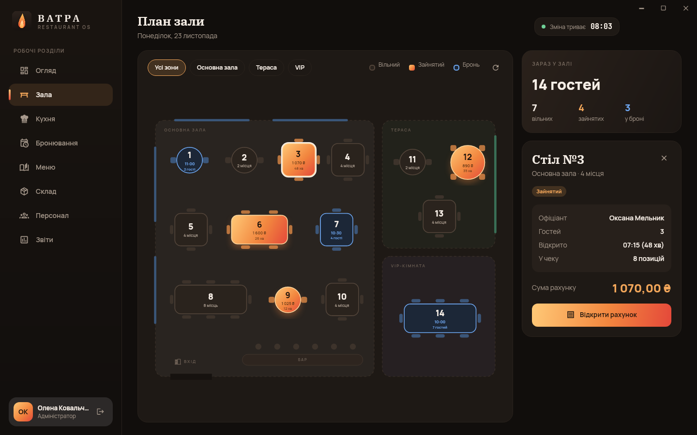
</p>

---

## Зміст

- [Про проєкт](#про-проєкт)
- [Можливості](#можливості)
- [Скріншоти](#скріншоти)
- [Запуск](#запуск)
- [Демо-облікові записи](#демо-облікові-записи)
- [Архітектура](#архітектура)
- [Модель даних](#модель-даних)
- [Бізнес-правила](#бізнес-правила)
- [Інтерфейс](#інтерфейс)
- [Тестування](#тестування)
- [Структура репозиторію](#структура-репозиторію)

## Про проєкт

«Ватра» — це настільний застосунок для автоматизації роботи ресторану. Він охоплює весь
цикл обслуговування гостя: бронювання столу → відкриття рахунку на плані зали → замовлення
страв → приготування на кухні → списання продуктів зі складу → розрахунок і друк чеку →
аналітика продажів.

Система розрахована на три ролі з різними правами доступу:

| Роль | Доступні розділи |
|---|---|
| **Адміністратор** | Огляд, Зала, Кухня, Бронювання, Меню, Склад, Персонал, Звіти |
| **Офіціант** | Зала, Кухня, Бронювання |
| **Кухар** | Кухня, Склад |

## Можливості

**Огляд (дашборд)**
- ключові показники зміни: виручка (з порівнянням із учорашнім днем), кількість чеків, середній чек, зайнятість залу, сума відкритих рахунків;
- інтерактивна діаграма виручки за 14 днів і кільцева діаграма структури продажів за категоріями;
- хіти продажів, стан кухні, найближчі бронювання, сповіщення про нестачу продуктів, пікові години.

**План зали**
- інтерактивна схема з трьома зонами (основна зала, тераса, VIP), столами різної форми та стільцями;
- колір столу показує стан: вільний / зайнятий (сума та час обслуговування) / заброньований;
- фільтр за зонами, бічна панель з деталями столу, швидке відкриття рахунку.

**POS-екран офіціанта**
- меню з пошуком і фільтром за категоріями, позначка «стоп-лист»;
- «паперовий» чек: кількість, коментарі для кухні («без цибулі»), статус кожної позиції;
- передача на кухню, розрахунок зі знижкою (0–20 %), готівкою (з підрахунком решти) або карткою;
- формування фіскального чеку з можливістю збереження у файл.

**Кухонний монітор**
- канбан-дошка «Нові → Готуються → Готові до видачі»;
- таймер для кожної страви з контролем нормативного часу та підсвічуванням затримок;
- автоматичне оновлення черги.

**Меню та технологічні карти**
- категорії й страви (ціна, вихід, час приготування, опис, доступність);
- технологічна карта страви: інгредієнти та їх кількість на порцію;
- автоматичний розрахунок собівартості та маржі.

**Склад**
- залишки продуктів з індикатором рівня запасу та статусами «Норма / Мало / Критично»;
- автоматичне списання інгредієнтів за техкартами під час передачі замовлення на кухню;
- оприбуткування товару, вартість запасів.

**Бронювання**
- календарна стрічка на 14 днів, таймлайн бронювань на день;
- перевірка місткості столу та перетину бронювань у часі;
- «Гості прийшли» — одразу відкриває рахунок на заброньованому столі.

**Персонал** — облікові записи, ролі, блокування доступу, результати офіціантів за місяць.

**Звіти** — виручка, чеки, середній чек, гості, валова маржа за обраний період з порівнянням із
попереднім; динаміка по днях, завантаженість за годинами, категорії, способи оплати, топ-10 страв,
рейтинг офіціантів; **експорт у CSV** (відкривається в Excel).

## Скріншоти

| | |
|---|---|
| 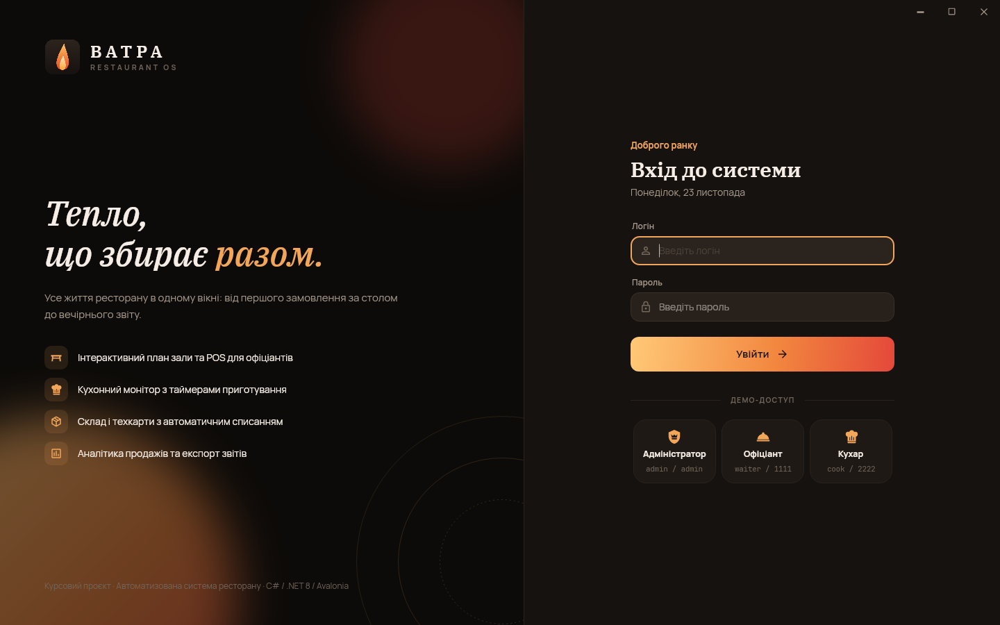 | 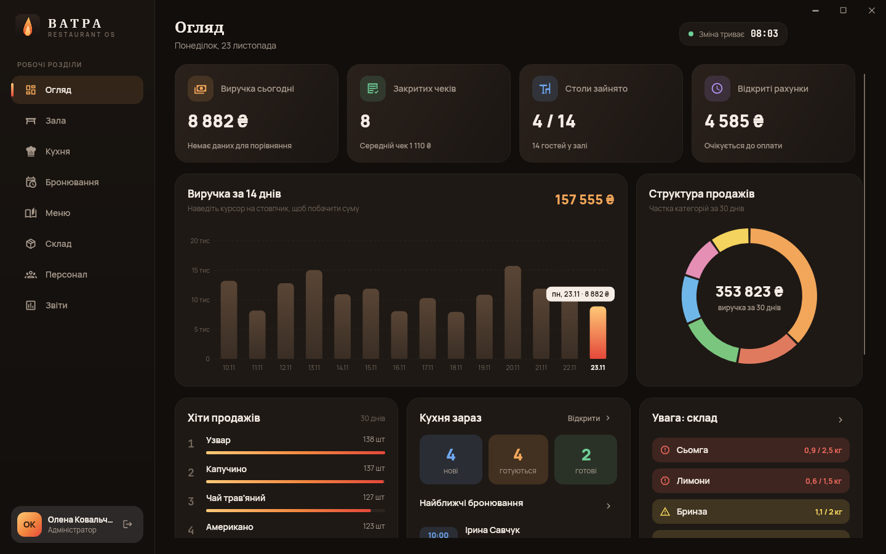 |
| **Вхід до системи** | **Огляд** |
| 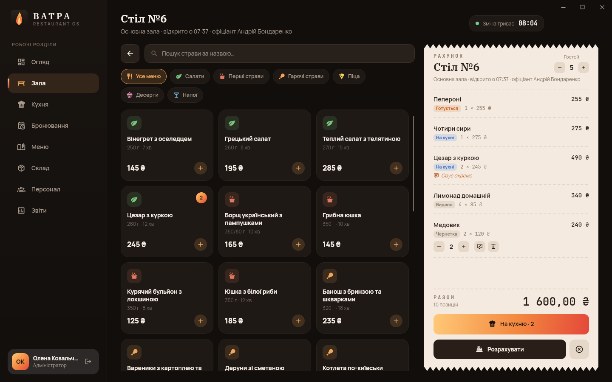 | 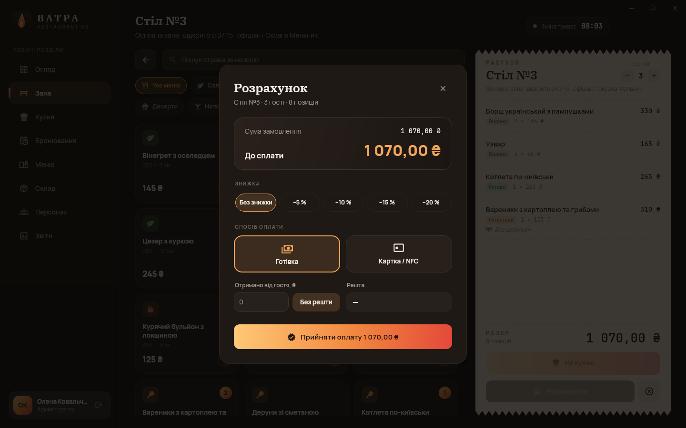 |
| **POS-екран із «паперовим» чеком** | **Розрахунок гостя** |
| 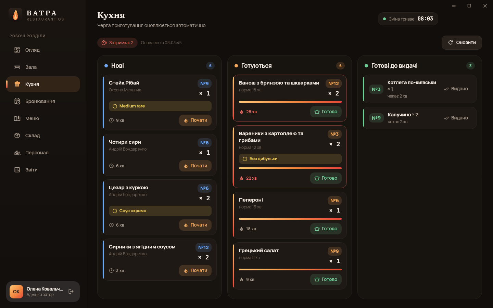 | 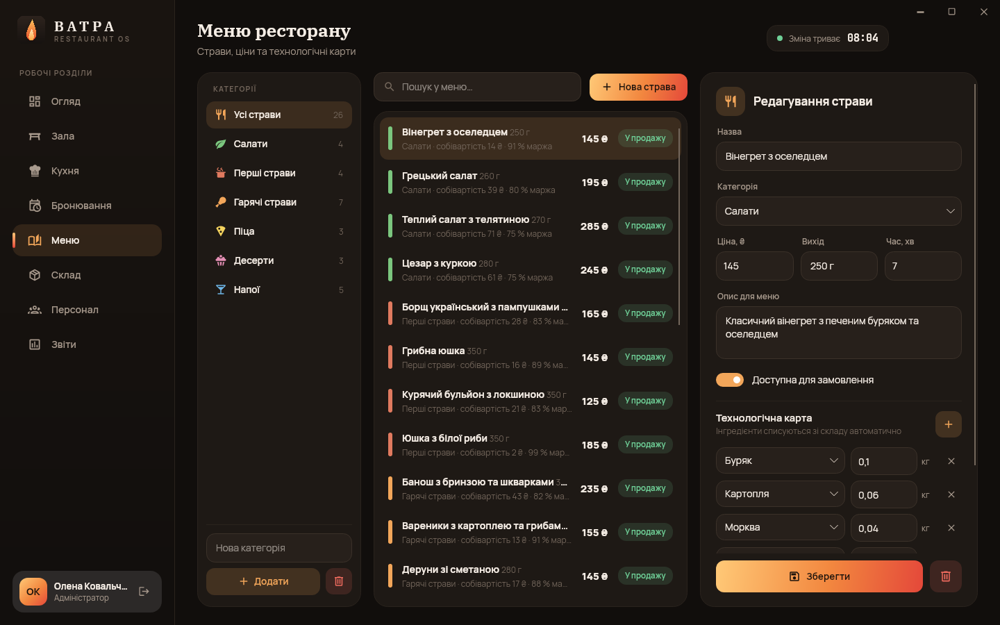 |
| **Кухонний монітор** | **Меню та техкарти** |
| 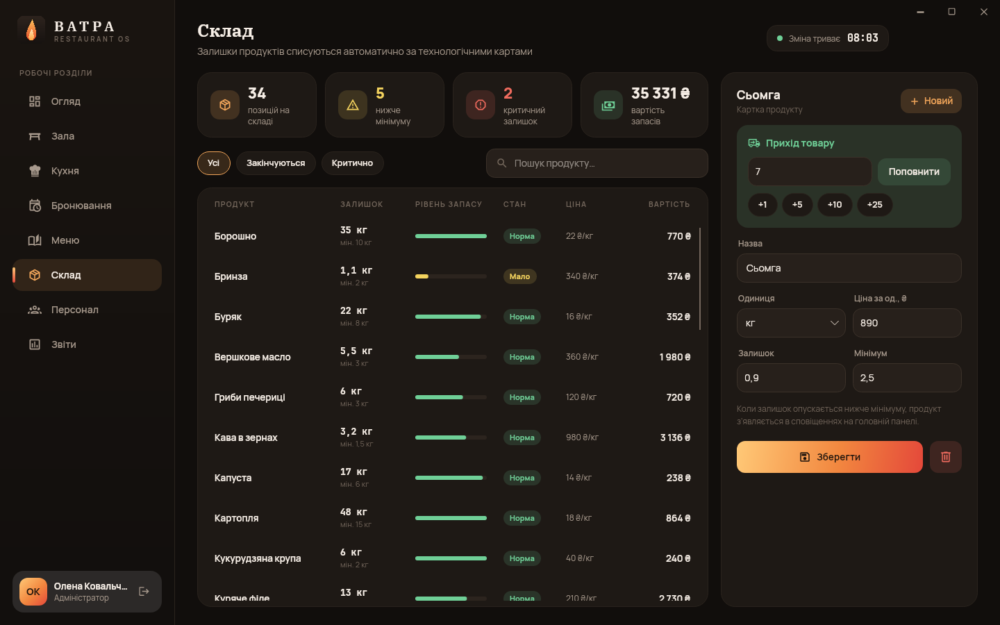 | 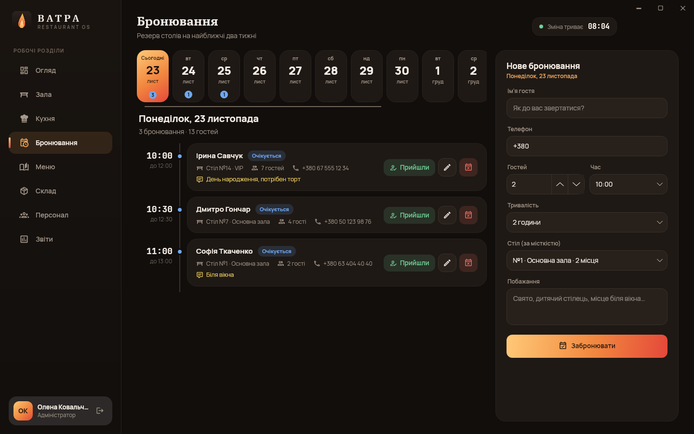 |
| **Склад** | **Бронювання** |
| 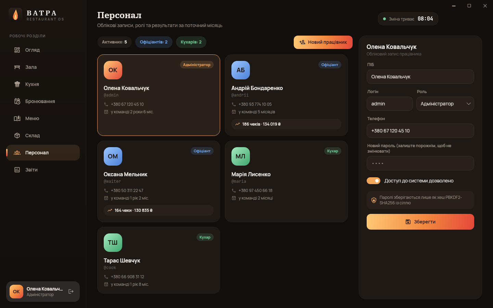 | 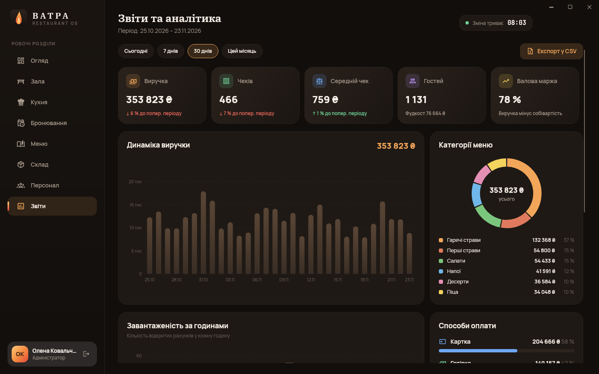 |
| **Персонал** | **Звіти та аналітика** |

## Запуск

### Вимоги
- [.NET 8 SDK](https://dotnet.microsoft.com/download/dotnet/8.0)
- Windows 10/11, macOS або Linux
- IDE (за бажанням): Visual Studio 2022 17.8+ або JetBrains Rider.
  Для зручного редагування `.axaml` у Visual Studio встановіть розширення **Avalonia for Visual Studio**.

### Visual Studio / Rider
1. Відкрийте `RestaurantSystem.sln`.
2. Оберіть проєкт `RestaurantSystem` як стартовий і натисніть **F5**.

NuGet-пакети відновляться автоматично під час першої збірки.

### Командний рядок
```bash
dotnet run --project src/RestaurantSystem
```

### Окремий .exe для Windows
```bash
dotnet publish src/RestaurantSystem -c Release -r win-x64 --self-contained -p:PublishSingleFile=true -o publish
```

### Дані
Під час першого запуску створюється база даних SQLite і наповнюється демонстраційними даними:
персонал, меню з 26 стравами та техкартами, 34 продукти на складі, 14 столів,
історія замовлень за 3 місяці, активні замовлення та бронювання.

| ОС | Розташування БД |
|---|---|
| Windows | `%LOCALAPPDATA%\VatraRestaurant\restaurant.db` |
| Linux | `~/.local/share/VatraRestaurant/restaurant.db` |
| macOS | `~/Library/Application Support/VatraRestaurant/restaurant.db` |

Щоб повернутися до початкових даних, закрийте застосунок і видаліть цей файл.
Чеки та звіти зберігаються в теці `Документи/Ватра`.

## Демо-облікові записи

| Роль | Логін | Пароль |
|---|---|---|
| Адміністратор | `admin` | `admin` |
| Офіціант | `waiter` | `1111` |
| Офіціант | `andrii` | `1111` |
| Кухар | `cook` | `2222` |
| Кухар | `maria` | `2222` |

На екрані входу можна просто натиснути картку потрібної ролі — дані підставляться автоматично.

## Архітектура

Застосунок побудовано за шаблоном **MVVM** із розділенням на шари:

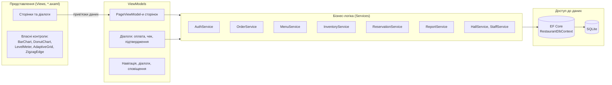

- **Views** містять лише розмітку; уся логіка — у ViewModels. Зв'язок через *compiled bindings*
  (помилки прив'язок виявляються під час компіляції).
- **ViewModels** використовують CommunityToolkit.Mvvm (`[ObservableProperty]`, `[RelayCommand]`).
- **Services** інкапсулюють бізнес-правила і не залежать від UI — тому їх легко покрити модульними тестами.
  Порушення правил повідомляються винятком `BusinessException`, який UI показує як сповіщення.
- **Dependency Injection** (`Microsoft.Extensions.DependencyInjection`) збирає залежності в `App.axaml.cs`.
- **Навігація** — `NavigationService` + `ViewLocator`, що автоматично зіставляє `XxxViewModel → XxxView`.
- **Діалоги** відображаються всередині вікна поверх затемнення (`DialogService`) і повертають результат через `Task<T>`.
- **Доступ до даних** — EF Core: кожна операція створює короткоживучий `DbContext` через `DbContextFactory`.

### Технології

| Призначення | Бібліотека |
|---|---|
| UI-фреймворк | Avalonia UI 11 (Fluent theme + власні стилі) |
| MVVM | CommunityToolkit.Mvvm |
| ORM / БД | Entity Framework Core 8 + SQLite |
| DI-контейнер | Microsoft.Extensions.DependencyInjection |
| Іконки | Material.Icons.Avalonia |
| Тести | xUnit |

## Модель даних

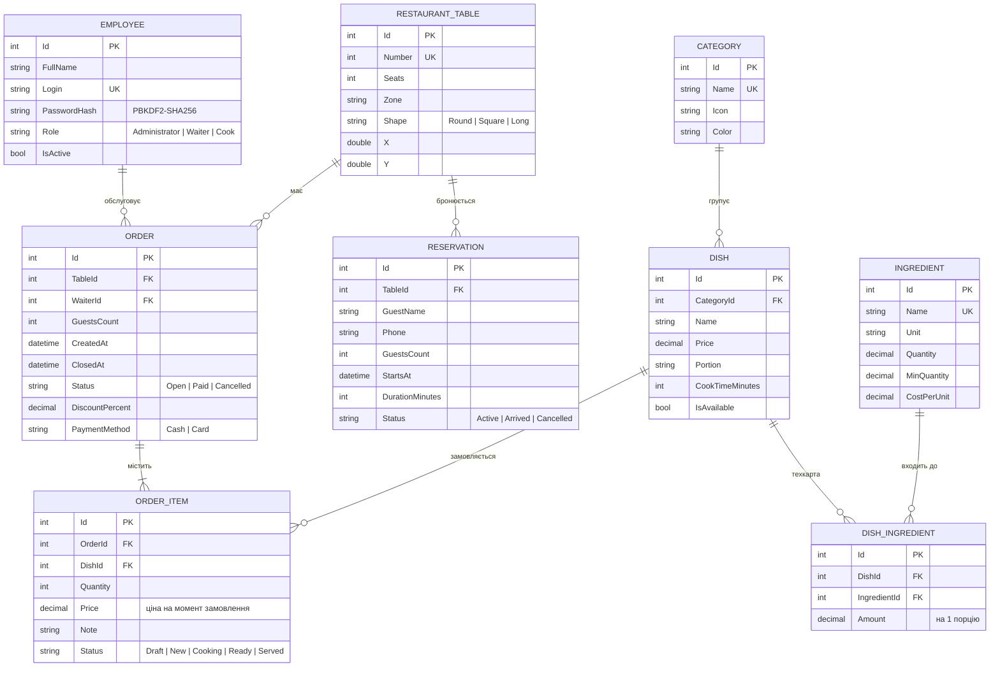

## Бізнес-правила

**Життєвий цикл позиції замовлення**

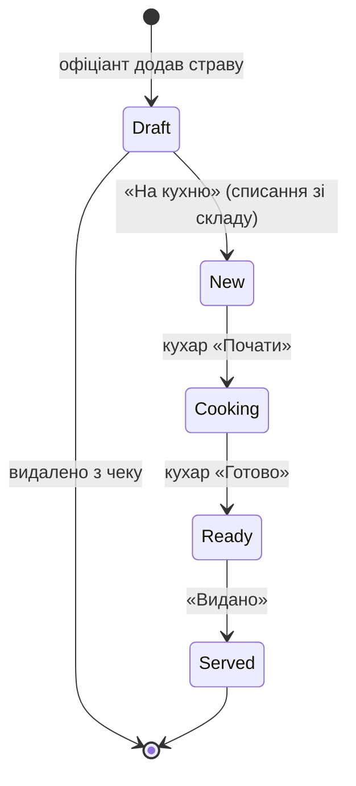

- На одному столі може бути лише один відкритий рахунок.
- Змінювати кількість, коментар або видаляти можна лише позиції у статусі «Чернетка».
- Однакові страви з однаковим коментарем об'єднуються в один рядок.
- Під час передачі на кухню інгредієнти списуються за техкартою (кількість на порцію × кількість порцій);
  система попереджає, якщо залишок продукту став нижчим за мінімальний.
- Скасувати рахунок можна лише до передачі страв на кухню; порожній рахунок скасовується автоматично.
- Ціна фіксується в позиції в момент замовлення — зміна меню не впливає на історію та звіти.
- Страву, що є в історії замовлень, не видаляють фізично — її знімають з продажу.
- Бронювання: кількість гостей не може перевищувати місткість столу; активні бронювання одного столу
  не можуть перетинатися в часі.
- Паролі зберігаються лише як хеш PBKDF2-HMAC-SHA256 (100 000 ітерацій, випадкова сіль).
- Адміністратор не може заблокувати себе чи зняти з себе роль адміністратора.

## Інтерфейс

Інтерфейс навмисно відходить від стандартного вигляду Windows-форм:

- **Власний заголовок вікна** — без системної рамки; перетягування за верхню панель, подвійний клік розгортає вікно.
- **Тема «Ватра»** — темний «еспресо»-фон, бурштиново-вогняні градієнти; уся палітра зібрана в `Styles/Palette.axaml`.
- **Типографіка** — Manrope (інтерфейс), IBM Plex Serif (заголовки), JetBrains Mono (чеки, цифри).
- **Власні контроли**, намальовані вручну через `DrawingContext`: стовпчикова діаграма з підказками,
  кільцева діаграма з підсвічуванням сегментів, індикатори рівня, зубчастий край «паперового» чеку,
  адаптивна сітка карток.
- **Інтерактивний план зали** зі столами різної форми та стільцями.
- **Модальні вікна всередині застосунку**, спливаючі сповіщення та анімації появи сторінок.

## Тестування

Бізнес-логіку покрито **51 модульним тестом** (xUnit, SQLite у пам'яті):

```bash
dotnet test
```

Перевіряються: хешування паролів, автентифікація і блокування, відкриття/закриття рахунків,
об'єднання позицій, списання інгредієнтів за техкартами, життєвий цикл страви на кухні, розрахунок
знижок, перетин бронювань і місткість столів, агрегування звітів і експорт CSV, правила меню та складу,
відмінювання українських числівників, формування чеку.

## Структура репозиторію

```
├── RestaurantSystem.sln
├── src/RestaurantSystem/
│   ├── Assets/            логотип, іконка, шрифти
│   ├── Controls/          власні контроли (діаграми, індикатори, сітка)
│   ├── Data/              DbContext, фабрика контекстів, демо-дані
│   ├── Infrastructure/    навігація, діалоги, сповіщення, форматування
│   ├── Models/            сутності предметної області
│   ├── Services/          бізнес-логіка
│   ├── Styles/            палітра та стилі контролів
│   ├── ViewModels/        логіка представлення (MVVM)
│   ├── Views/             розмітка екранів (*.axaml)
│   ├── App.axaml(.cs)     ресурси, тема, DI-контейнер
│   └── Program.cs         точка входу
├── tests/RestaurantSystem.Tests/   модульні тести
└── docs/screenshots/               скріншоти
```
